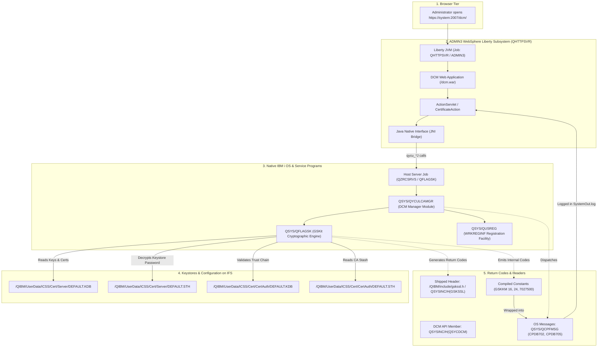

# IBM i Digital Certificate Manager (DCM), ADMIN3 & GSKit Architecture Deep Dive

## Table of Contents
1. [Why This All Matters](#why-this-all-matters)
2. [End-to-End System Architecture](#end-to-end-system-architecture)
3. [The 5 Distinct Return Code Domains on IBM i](#the-5-distinct-return-code-domains-on-ibm-i)
4. [DCM Java UI to Native JNI Bridge Matrix](#dcm-java-ui-to-native-jni-bridge-matrix)
5. [The 5-Layer Failure Deduction Flow (e.g. CPDB702 / RC 16 / RC 24)](#the-5-layer-failure-deduction-flow)
6. [EBCDIC Code Page 037 Parameter Decoding](#ebcdic-code-page-037-parameter-decoding)
7. [Shipped System Objects vs. Internal IBM Development Headers](#shipped-system-objects-vs-internal-ibm-development-headers)
8. [Interactive Tooling & Hover Tooltip Engine](#interactive-tooling--hover-tooltip-engine)

---

## 1. Why This All Matters

Digital Certificate Manager (DCM) is the core security cornerstone of IBM i. Every TLS/SSL-enabled application on the system—including:
- **HTTPS Servers (`*ADMIN`, Apache HTTP Server for i)**
- **Host Servers (Secure Telnet 992, Central Client, Database Sockets)**
- **IBM WebSphere Application Server & Liberty Profiles**
- **Db2 Mirror for i & Q-Replication**
- **External Web Service / REST Consumers (`HTTPGETCLOB`, JNI SSL)**

depends directly on the certificate key databases (`.KDB`), password stash files (`.STH`), and the Registration Facility (`WRKREGINF`).

When a certificate operation fails, administrators typically see cryptic errors in `SystemOut.log` (such as `rc: 16`, `rc: 24`, or `pof = 247`) or symptom codes like `5770 SP/QYCULCAMGR RC7027500`. Without understanding the multi-tier translation between Java, JNI, GSKit C engines, and IFS stores, diagnosing these issues requires hours of trial-and-error.

---

## 2. End-to-End System Architecture



---

## 3. The 5 Distinct Return Code Domains on IBM i

| Layer | Domain | Example Code / ID | Source Location / Visibility | Description |
| :---: | :--- | :--- | :--- | :--- |
| **5** | **OS Messages** | `CPDB702`, `CPDB705`, `CPDB708` | `QSYS/QCPFMSG` (via `DSPMSGD`) | User-facing diagnostic messages dispatched to joblogs. |
| **4** | **Symptom Codes** | `RC7027500`, `RC5003000` | Support / Service Programs | 7-digit failure strings decomposed as `[Entry Point 3-digit][Utility 2-digit][Offset 2-digit]`. |
| **3** | **GSKSSL Public Header** | `0` (`GSK_OK`), `6000` (`NOT_TRUSTED`), `6019` (`NO_DEFAULT_CERT`) | `/QIBM/include/gskssl.h`<br>`QSYSINC/H(GSKSSL)` | Public TLS/SSL API return codes for application developers. |
| **2** | **GSKKM Cryptographic Engine** | `16` (`INVALID_PASSWORD`), `24` (`CRYPTO`), `308` (`StashKdbPwd`) | Internal GSKit Key Management (`gskkmerr.h`) | Internal engine return codes emitted when opening CMS keystores. |
| **1** | **QYCU Internal Enums** | `3849` (`PASSWORD_NOTEQUAL`), `3932` (`KDB_EXISTS`) | Internal DCM Header (`qycuretcodes.H`) | Internal error enums returned by `QYCU*` service programs. |

---

## 4. DCM Java UI to Native JNI Bridge Matrix

When actions are taken in the DCM browser interface, the Java classes delegate to native IBM i service programs using JNI methods ending in `J`:

| Native C Routine | JNI Wrapper in Log | Purpose | Return Codes |
| :--- | :--- | :--- | :--- |
| `qycu_listCertificates` | `qycu_listCertificatesJ` | List certificates in `.KDB` store | `0`, `16`, `24`, `6000`, `6019` |
| `qycu_open_key_db` | `qycu_open_key_dbJ` | Open keystore using `.STH` password | `0`, `16`, `19`, `24`, `78`, `81`, `82` |
| `qycu_assignCertToApp` | `qycu_assignCertToAppJ` | Assign certificate to Application ID | `0`, `6007`, `6019`, `3985` |
| `qycu_createKeyDatabase` | `qycu_createKeyDatabaseJ` | Initialize a new CMS keystore | `0`, `8`, `9`, `3932` |
| `qycu_stashPassword` | `qycu_stashPasswordJ` | Create / update `.STH` stash file | `0`, `308`, `329` |
| `qycu_validateCertificate` | `qycu_validateCertJ` | Validate certificate path & expiry | `0`, `34`, `42`, `45`, `47`, `6000` |
| `qycu_importCertificate` | `qycu_importCertJ` | Import PKCS#12 (`.p12`) / Base64 | `0`, `85`, `87`, `112`, `113` |
| `qycu_exportCertificate` | `qycu_exportCertJ` | Export certificate & private key | `0`, `113`, `3971` |

---

## 5. The 5-Layer Failure Deduction Flow

### Example: How `rc: 16` or `rc: 24` Extrapolates to `CPDB702` (.STH Password Mismatch)

```
┌────────────────────────────────────────────────────────────────────────┐
│ Layer 1: Native Keystore Decryption                                    │
│ QSYS/QFLAGSK & GSKit invoke gsk_environment_init() / qycu_open_key_db()│
│ to open /QIBM/UserData/ICSS/Cert/Server/DEFAULT.KDB.                   │
└─────────────────────────────────┬──────────────────────────────────────┘
                                  ▼
┌────────────────────────────────────────────────────────────────────────┐
│ Layer 2: Password Stash (.STH) Extraction                              │
│ To open the CMS keystore non-interactively without prompting, runtime   │
│ reads the obfuscated password hash from DEFAULT.STH.                   │
└─────────────────────────────────┬──────────────────────────────────────┘
                                  ▼
┌────────────────────────────────────────────────────────────────────────┐
│ Layer 3: Low-Level Crypto Engine Mismatch (RC 16 / RC 24)              │
│ If DEFAULT.KDB password was changed, expired, or .STH was copied from   │
│ another system, the hash cannot decrypt the keystore master key.       │
│ Crypto engine returns RC 16 (GSKKM_ERR_DATABASE_INVALID_PASSWORD) or    │
│ RC 24 (GSKKM_ERR_CRYPTO).                                              │
└─────────────────────────────────┬──────────────────────────────────────┘
                                  ▼
┌────────────────────────────────────────────────────────────────────────┐
│ Layer 4: DCM Symptom Code Translation (RC 7027500)                     │
│ QYCULCAMGR catches the failure at Major Entry Point 702 (Password      │
│ Verification) and utility 7500, generating symptom RC 7027500.         │
└─────────────────────────────────┬──────────────────────────────────────┘
                                  ▼
┌────────────────────────────────────────────────────────────────────────┐
│ Layer 5: IBM i Diagnostic Message Dispatch (CPDB702)                   │
│ IBM i maps this failure to OS message CPDB702:                         │
│ "The certificate store password or password stash file (.STH) is       │
│ invalid, corrupted, or out of sync with the key database."             │
└────────────────────────────────────────────────────────────────────────┘
```

---

## 6. EBCDIC Code Page 037 Parameter Decoding

IBM i host servers (`QZRCSRVS`) communicate with the Java WebSphere/Liberty layer using raw hexadecimal byte streams encoded in **EBCDIC Code Page 037 (`CP037`)**.

Our diagnostic tool automatically decodes these in-place:

| Parameter | Hex Stream Sample | Decoded EBCDIC Value | Meaning |
| :--- | :--- | :--- | :--- |
| **Keystore Path** | `61D8C9C2D461E4E2C5...` | `"/QIBM/UserData/ICSS/Cert/Server/DEFAULT.KDB"` | Target CMS Key Database |
| **CA Keystore Path** | `61D8C9C2D461E4E2C5...` | `"/QIBM/UserData/ICSS/Cert/CertAuth/DEFAULT.KDB"`| Certificate Authority Store |
| **Filter Flag** | `C8C1E2D7D9C9E5C1E3C5D2C5E800` | `"HASPRIVATEKEY"` | Query only certs with private keys |
| **Key Scope** | `C1D3D36DD2C5E8E200` | `"ALL_KEYS"` | List all keys in keystore |
| **Resource Bundle** | `8396944B8982944B8483944B998300`| `"com.ibm.dcm.rc"` | Java error message resource bundle |
| **Output RC (4-Byte)** | `00000010` | **`16` (0x10)** | **`GSKKM_ERR_DATABASE_INVALID_PASSWORD`** |

---

## 7. Shipped System Objects vs. Internal IBM Development Headers

| Include / Object | Status on Customer Systems | Location / Access Command |
| :--- | :--- | :--- |
| **`/QIBM/include/gskssl.h`** | ✅ **Shipped** (5770-SS1 Option 13) | `DSPF STMF('/QIBM/include/gskssl.h')` |
| **`QSYSINC/H(GSKSSL)`** | ✅ **Shipped** (5770-SS1 Option 13) | `DSPPFM FILE(QSYSINC/H) MBR(GSKSSL)` |
| **`QSYSINC/H(QSYCDCM)`** | ✅ **Shipped** (5770-SS1 Option 13) | `DSPPFM FILE(QSYSINC/H) MBR(QSYCDCM)` |
| **`QSYS/QFLAGSK`** | ✅ **Shipped** (OS Base Service Program) | `DSPOBJD OBJ(QSYS/QFLAGSK) OBJTYPE(*SRVPGM)` |
| **`gskkmerr.h`** | 🔒 **Internal IBM LIC Header** | Embedded at compile-time in `QFLAGSK` (Decoded via our catalog) |
| **`qycuretcodes.H`** | 🔒 **Internal IBM DCM Header** | Embedded at compile-time in `QYCU*` (Decoded via our catalog) |

---

## 8. Interactive Tooling & Hover Tooltip Engine

The web application [`dcm-service.war`](dcm-service.war) provides:
- **Global Floating Viewport Tooltips**: Renders fixed unclipped tooltips on hover over any `rc: 16`, `rc: 24`, `rc: 6000`, `return code = -1`, or hex return code (`00000010`).
- **In-Place Red EBCDIC Decoding**: Converts raw input/output hexadecimal strings into readable IFS paths and flags.
- **Root Cause Sequence Generation**: Automatically detects `CPDB702` or password mismatch conditions and renders the step-by-step diagnostic breakdown.
