# IBM i DCM Return Code & Symptom Search Web Application

### Target Runtime: **Integrated Application Server (IAS) v8.5+ / WebSphere Liberty 24.0.0.12+**
* **Operating System**: IBM i V7R5, V7R6, V7R4, V7R3, and future releases
* **Target Application Server**: IBM Integrated Application Server (IAS) v8.5 and above / WebSphere Application Server Liberty Profile
* **Context Root**: `/dcm-service`
* **Artifact Package**: `dcm-service.war`
* **Comprehensive Operator & User Guide**: See [`USER_GUIDE.md`](USER_GUIDE.md) for in-depth concepts, sorting techniques, recovery walkthroughs, CL cheatsheet, and technician tips.

---

## 🏗️ Architecture Overview: Standard REST vs. Interactive Web UI

In a standard web services workflow, requests are executed against an HTTP URL (via `GET` query parameters or a `POST` JSON payload). The raw JSON result is typically inspected in tools like Postman or rendered as plain JSON text.

The **`dcm-service`** application delivers a self-contained, zero-dependency interactive client-side web application directly inside the WAR archive. This interface bridges standard backend REST endpoints with an interactive dashboard:

```mermaid
graph TD
    subgraph Traditional_REST_Postman_Flow [Standard REST / Postman Flow]
        A1["Developer Manual Input"] --> B1["HTTP GET / POST /api/dcm/decode"]
        B1 --> C1["IAS / Liberty JAX-RS Backend"]
        C1 --> D1["Raw JSON Response String"]
        D1 --> E1["Manual JSON Inspection in Postman"]
    end

    subgraph DCM_Service_Interactive_UI_Flow [dcm-service Interactive Web UI Flow]
        A2["User Input Query Box (textarea)"] --> B2["JavaScript Event Controller (performSearch)"]
        B2 --> C2["Deconstruction Engine (searchDcmEngine)"]
        C2 --> D2["Mathematical Decomposition: xxxyyyyzz"]
        D2 --> E2["Dynamic DOM Card Generator (renderDeconstructedResult)"]
        E2 --> F2["Formatted 4-Column CSS Grid & Status Badges"]
    end
```



---

## 🌟 Key Application Features

1. **Native WebSphere Liberty 24.0.0.12+ / IAS Compliance**:
   * Uses standard Java EE 8 / Servlet 3.1 / JAX-RS specifications.
   * Standard `.war` packaging with zero external runtime dependencies.

2. **DCM Return Code Mathematical Deconstruction**:
   * Deconstructs return codes using the official IBM DCM formula:
     $$\text{Point of Failure} = \mathbf{xxx} \text{ (Major Entry Point)} + \mathbf{yyyy} \text{ (Utility Function)} + \mathbf{zz} \text{ (Local Minor Point)}$$
     * **`xxx` (Major Entry Point)**: Multiples of 1,000,000 across all 9 Service Program Managers (`QYCUAPPMGR`, `QYCULCAMGR`, `QYCUCTMGR`, `QYCUCSMGR`, `QYCUGENMGR`, `QYCUHDWMGR`, `QYCUUCMGR`, `QYCUYDOMGR`).
     * **`yyyy` (Utility Point of Failure)**: Defined in header `qycuutl.H` (95+ utility routines).
     * **`zz` (Local Point of Failure)**: Specific internal manager module offset codes (Tables 2, 4, 5, 7, 8).

3. **Multi-Tier Search Capabilities**:
   * **Exact Symptom String Matching**: `5770 SP/QYCULCAMGR MOD/QYCULCAMGR RC7027500`
   * **Fuzzy & Closest Match**: If an exact code is not found, calculates $\Delta$ offsets and lists the closest documented return codes.
   * **Keyword & Regex Search**: Search across constants like `RECEIVECERT`, `STORE`, `APPLIST`, or regular expressions.
   * **Technician Action Support**: Prompts support technicians to *"Search iAI assisted support searches in CSP"* when non-standard codes are identified.

4. **Hardware Cryptographic Coprocessor Support**:
   * Comprehensive coverage of PCIe cryptographic coprocessors (IBM 4767, 4769, 4770, Enterprise PKCS#11, and CCA APIs).

5. **Zero-404 Browser Engine**:
   * Search and parsing algorithms run completely client-side in standard JavaScript, eliminating network latency and 404 HTTP errors.

---

## 💻 Detailed UI Implementation: Query Box, Controller, & Dynamic Formatting

The web interface replaces raw JSON with interactive, formatted cards and tables using three core layers:

```
┌─────────────────────────────────────────────────────────────┐
│ 1. HTML5 Query Box & Preset Samples (User Input Layer)      │
├─────────────────────────────────────────────────────────────┤
│ 2. JavaScript Controller & Parser (Logic Execution Layer)   │
├─────────────────────────────────────────────────────────────┤
│ 3. Dynamic DOM Generator & CSS Grid (Visual Output Layer)   │
└─────────────────────────────────────────────────────────────┘
```

### 1. HTML5 Input Query Box Structure
Located in [`src/main/webapp/index.html`](src/main/webapp/index.html):
```html
<!-- Input Query Card -->
<div class="search-card">
    <div class="input-group">
        <label id="inputLabel" for="symptomInput">
            Enter Symptom String(s), Return Code(s), or Service Program:
        </label>
        <textarea id="symptomInput" rows="4" 
            placeholder="e.g. 5770 SP/QYCULCAMGR MOD/QYCULCAMGR RC7027500&#10;or: QYCUAPPMGR 5003000&#10;or: 7027500">
        </textarea>
    </div>

    <!-- Quick Example Presets -->
    <div class="samples" id="sampleRow">
        <span>Quick Examples:</span>
        <button class="sample-btn" onclick="setSample('5770 SP/QYCULCAMGR MOD/QYCULCAMGR RC7027500')">
            RC7027500 (Local CA)
        </button>
        <button class="sample-btn" onclick="setSample('5722 SP/QYCUAPPMGR MOD/QYCUAPPMGR RC5003000')">
            RC5003000 (App Mgr + Util)
        </button>
    </div>

    <!-- Action Buttons -->
    <div class="btn-row">
        <button class="btn-primary" onclick="performSearch()">Search & Deconstruct</button>
        <button class="btn-secondary" onclick="clearResults()">Clear</button>
    </div>
</div>

<!-- Output Target Container -->
<div id="results" class="results-container"></div>
```

---

### 2. JavaScript Event Controller (`performSearch()`)
This function orchestrates input reading, clears previous searches, and loops through multi-line inputs:
```javascript
function performSearch() {
    // 1. Extract input lines from the textarea
    const input = document.getElementById("symptomInput").value;
    const lines = input.split(/\r?\n/).filter(l => l.trim().length > 0);
    const resultsContainer = document.getElementById("results");
    
    // 2. Clear old results
    resultsContainer.innerHTML = "";

    if (lines.length === 0) {
        resultsContainer.innerHTML = `
            <div class="result-card">
                <div class="result-title">No Input Provided</div>
                <p>Please enter a symptom string or keyword in the box above.</p>
            </div>`;
        return;
    }

    // 3. Process each line through the deconstruction engine
    lines.forEach((line) => {
        const res = searchDcmEngine(line);
        if (!res) return;

        if (res.isKeywordSearch) {
            renderKeywordResults(res);
        } else if (res.success) {
            renderDeconstructedResult(res); // Generates visual cards
        } else {
            renderNotFoundOrClosest(res);
        }
    });
}
```

---

### 3. Dynamic HTML Card Generator (`renderDeconstructedResult(res)`)
This function transforms the deconstructed data into structured DOM nodes with 4-column breakdown grids:
```javascript
function renderDeconstructedResult(res) {
    const resultsContainer = document.getElementById("results");
    const card = document.createElement("div");
    card.className = "result-card" + (res.isClosest ? " closest-match" : "");

    card.innerHTML = `
        <!-- Header with Exact / Closest Status Badge -->
        <div class="result-header">
            <div>
                <div class="result-title">${res.sp} &bull; RC ${res.rc}</div>
                <div class="result-sub">${res.raw}</div>
            </div>
            <span class="result-badge ${res.isExact ? 'badge-exact' : 'badge-closest'}">
                ${res.isExact ? 'Exact Match' : 'Closest Decomposition'}
            </span>
        </div>

        <!-- 4-Column Mathematical Breakdown Grid -->
        <div class="decomp-grid">
            <div class="decomp-item">
                <div class="decomp-label">Service Program</div>
                <div class="decomp-val">${res.sp}</div>
                <div class="decomp-sub">${res.serviceProgramName}</div>
            </div>
            <div class="decomp-item">
                <div class="decomp-label">Major Entry Point (xxx)</div>
                <div class="decomp-val">${res.entryName}</div>
                <div class="decomp-sub">Value: +${res.entryVal}</div>
            </div>
            <div class="decomp-item">
                <div class="decomp-label">Utility Function (yyyy)</div>
                <div class="decomp-val">${res.utilName || 'None (Direct Module Failure)'}</div>
                <div class="decomp-sub">${res.utilCategory ? res.utilCategory + ' (+' + res.utilVal + ')' : 'No utility failure'}</div>
            </div>
            <div class="decomp-item">
                <div class="decomp-label">Local Point of Failure (zz)</div>
                <div class="decomp-val">${res.localName || (res.localVal > 0 ? '+' + res.localVal : '00 (Normal Entry)')}</div>
                <div class="decomp-sub">${res.localVal > 0 ? 'Local offset in module' : 'No local offset'}</div>
            </div>
        </div>

        <!-- Root Cause Diagnostic Explanation Box -->
        <div class="explanation-box ${res.isClosest ? 'warning-tone' : ''}">
            <div class="explanation-title">Diagnostic Use Case & Root Cause Method</div>
            <div class="explanation-text">${res.explanation}</div>
        </div>
    `;

    resultsContainer.appendChild(card);
}
```

---

### 4. CSS Card & Grid Layout
```css
/* Card Container */
.result-card {
    background: #ffffff;
    border-radius: 8px;
    padding: 22px;
    box-shadow: 0 2px 8px rgba(0,0,0,0.06);
    border-left: 5px solid #0f62fe; /* IBM Carbon Blue */
    border-top: 1px solid #e0e0e0;
    border-right: 1px solid #e0e0e0;
    border-bottom: 1px solid #e0e0e0;
    margin-bottom: 18px;
}

/* 4-Column Responsive Grid */
.decomp-grid {
    display: grid;
    grid-template-columns: repeat(auto-fit, minmax(220px, 1fr));
    gap: 12px;
    margin-bottom: 16px;
}

.decomp-item {
    background: #f8fafc;
    border: 1px solid #e2e8f0;
    border-radius: 6px;
    padding: 12px 14px;
}

.decomp-label {
    font-size: 0.72rem;
    text-transform: uppercase;
    color: #525252;
    font-weight: 700;
}

.decomp-val {
    font-size: 0.95rem;
    font-weight: 700;
    color: #0f62fe;
    font-family: monospace;
}
```

---

## 🔐 IBM i Authorities Required to Access HTTPAdmin GUI

To access and administer applications via **IBM Web Administration for i** (`http://<YOUR_IBMI_HOST>:2001/HTTPAdmin`), the user profile on IBM i must have appropriate special authorities, function usage registrations, and object permissions.

### 1. User Profile Special Authorities
| Special Authority | Description | Reason Required |
| :--- | :--- | :--- |
| **`*IOSYSCFG`** | Input/Output System Configuration | Required to configure TCP/IP servers, HTTP server instances, ports, and Liberty environments. |
| **`*JOBCTL`** | Job Control | Required to start (`STRTCPSVR`), stop (`ENDTCPSVR`), and manage server jobs running in the `QHTTPSVR` subsystem. |
| **`*ALLOBJ`** | All Object Authority | Required for comprehensive administrative capabilities (creating instance directories, modifying server configuration files). |
| **`*SECADM` / `*SECOFR`** | Security Administrator / Security Officer | User Class required if managing certificates or security roles. |

### 2. Function Usage IDs (`WRKFCNUSG`)
If operating without full `*ALLOBJ` authority, the user profile must be explicitly authorized to the following Function IDs:
* **`QIBM_WLS_ADMIN`**: Web Administration - Liberty & Integrated Application Server Administration.
* **`QIBM_HTTP_SERVER_ADMIN`**: HTTP Server for i Administration.
* **`QIBM_IAS_ADMIN`**: Integrated Application Server Administrator.

To grant function usage authority from an IBM i command line:
```cl
SETFCNUSG FCNID(QIBM_WLS_ADMIN) USER(<USER_PROFILE>) USAGE(*ALLOWED)
SETFCNUSG FCNID(QIBM_HTTP_SERVER_ADMIN) USER(<USER_PROFILE>) USAGE(*ALLOWED)
```

### 3. Integrated File System (IFS) & Library Permissions
The user profile (or group) must possess:
* **`*RWX` (Read, Write, Execute)** data authority to:
  * `/QIBM/UserData/HTTPSVR`
  * `/www/<IAS_SERVER_NAME>/`
* **`*USE`** object authority to:
  * Library `QHTTPSVR`
  * Program `QSYS/QZHBDOC`
  * Commands `STRTCPSVR`, `ENDTCPSVR`

### 4. Starting the Administration Server Instance (`*ADMIN`)
Before accessing port 2001, ensure the `*ADMIN` server is active:
```cl
STRTCPSVR SERVER(*HTTP) HTTPSVR(*ADMIN)
```
Verify the jobs are running in subsystem `QHTTPSVR`:
```cl
WRKACTJOB SBS(QHTTPSVR) JOB(ADMIN*)
```

---

## 📁 Project Structure

```
dcm-service-v7r5/
├── pom.xml                                    # Maven build configuration for Liberty 24.0.0.12+ / IAS
├── README.md                                  # Complete Technical Architecture & Admin Guides
├── src/
│   └── main/
│       ├── java/com/ibmi/ias/
│       │   ├── RestApplication.java          # JAX-RS Application root (/api)
│       │   ├── api/
│       │   │   ├── DcmSearchResource.java    # REST search & decode endpoints
│       │   │   ├── StatusResource.java       # Health & OS diagnostics
│       │   │   └── ProgramResource.java      # Execute native IBM i *PGM via JT400
│       │   └── service/
│       │       ├── DcmSearchService.java     # Multi-tier fuzzy & closest-match DCM engine
│       │       └── ProgramCallerService.java # JT400 native program call handler
│       └── webapp/
│           ├── WEB-INF/web.xml               # Web deployment descriptor
│           └── index.html                    # Zero-dependency interactive Web UI
```

---

## 🔨 How to Build the WAR File

From the project root:
```powershell
mvn clean package
```
Output artifact:
```
target/dcm-service.war
```

---

## 🚀 How to Deploy on Integrated Application Server (IAS v8.5+ / Liberty)

The `dcm-service.war` archive is packaged using standard Java EE Servlet 3.1 / JAX-RS specifications and can be installed into any **Integrated Application Server (IAS) v8.5 or above** running on IBM i.

---

### Method 1: Using IBM Web Administration for i GUI (`HTTPAdmin` In-App Server Wizard)
1. **Ensure the Admin Server is Active**:
   ```cl
   STRTCPSVR SERVER(*HTTP) HTTPSVR(*ADMIN)
   ```
2. **Access Web Administration**:
   * Open your browser and navigate to: `http://<YOUR_IBMI_HOST>:2001/HTTPAdmin`
   * Log in with an authorized IBM i user profile (e.g., possessing `*IOSYSCFG` and `*JOBCTL` authorities).
3. **Navigate to the IAS Server Instance**:
   * Click on the **Manage** tab at the top.
   * Click on **Application Servers** (or **Integrated Application Servers**).
   * In the **Server** dropdown, select your target **IAS v8.5+** server instance (e.g., `IAS85` or your custom server name).
4. **Launch Install Wizard**:
   * Under **Server Tasks** in the left navigation pane, click **Install New Application**.
5. **Specify WAR Location**:
   * Choose **"The application is located on the system"** &rarr; enter the IFS path `/tmp/dcm-service.war`
     *(or choose "The application is located on your local file system" &rarr; click Browse &rarr; select `dcm-service.war` from your PC)*.
   * Click **Next**.
6. **Configure Application Properties**:
   * **Application Name**: `dcm-service`
   * **Context Root**: `/dcm-service`
   * Click **Next** &rarr; review settings &rarr; click **Finish**.
7. **Start Application / Server**:
   * If the IAS server is running, the application will automatically start. If stopped, click the green **Start** icon or run:
     ```cl
     STRTCPSVR SERVER(*HTTP) HTTPSVR(<IAS_SERVER_NAME>)
     ```

---

### Method 2: Dropins Directory Deployment (Fastest IFS Method)
On IBM i Integrated Application Server (IAS) v8.5+ and WebSphere Liberty instances, the **dropin folder** is located at:
```
/www/<instance>/wlp/usr/servers/<instance>/dropins
```

Where `<instance>` is the name of your IAS server instance.

#### Deployment Steps:
1. Transfer `dcm-service.war` to the IBM i IFS (e.g., `/tmp/dcm-service.war` using binary FTP, SFTP, or SCP).
2. Execute the CL copy command to place the WAR file directly into the dropin folder:
   ```cl
   CPY OBJ('/tmp/dcm-service.war') +
       TODIR('/www/<instance>/wlp/usr/servers/<instance>/dropins') +
       REPLACE(*YES)
   ```
3. The IAS runtime automatically detects the new archive in the `dropins` folder and deploys it dynamically at context root `/dcm-service` without requiring a server restart.

---

### Method 3: Direct `server.xml` Configuration (IAS v8.5 / Liberty)
To explicitly register the application with custom caching or classloading rules, edit `/www/<instance>/wlp/usr/servers/<instance>/server.xml`:
```xml
<server description="IBM Integrated Application Server v8.5+">
    <!-- Required Features -->
    <featureManager>
        <feature>webProfile-8.0</feature>
        <feature>jaxrs-2.1</feature>
        <feature>servlet-4.0</feature>
    </featureManager>

    <!-- dcm-service In-App Deployment -->
    <webApplication id="dcmService"
                    location="dcm-service.war"
                    name="dcmService"
                    contextRoot="/dcm-service"/>
</server>
```

---

### Method 4: Automated QShell CLI Deployment (`installapp.sh`)
For automated CI/CD pipelines or headless administration via IBM i QShell:
1. Start QShell on IBM i:
   ```cl
   QSH
   ```
2. Execute the IBM IAS application installation utility:
   ```bash
   /QIBM/ProdData/OS/OS400/bin/installapp.sh -server '<IAS_SERVER_NAME>' -app '/tmp/dcm-service.war' -contextRoot '/dcm-service'
   ```

---

## 🌐 Application URL Reference

| Resource | URL Pattern | Description |
| :--- | :--- | :--- |
| **Interactive Search Dashboard** | `http://<YOUR_IBMI_HOST>:<PORT>/dcm-service/` | Zero-dependency Web UI for symptom strings, closest match & regex search |
| **DCM Single Decode API** | `http://<YOUR_IBMI_HOST>:<PORT>/dcm-service/api/dcm/decode?symptom=5770%20SP/QYCULCAMGR%20MOD/QYCULCAMGR%20RC7027500` | REST API for single symptom deconstruction |
| **DCM Batch Search API** | `http://<YOUR_IBMI_HOST>:<PORT>/dcm-service/api/dcm/search` | REST API (POST) for batch searches |
| **Server Health & Diagnostics** | `http://<YOUR_IBMI_HOST>:<PORT>/dcm-service/api/status` | Returns OS version, Java version, and runtime status |

---

## 🔍 DCM Search Reference Matrix

| Symptom String | Service Program | Entry Point | Utility Function |
| :--- | :--- | :--- | :--- |
| `5770 SP/QYCULCAMGR MOD/QYCULCAMGR RC7027500` | `QYCULCAMGR` (Local CA) | `QYCU_RECEIVESERVERCERT` (`+7000000`) | `QYCU_RECEIVECERT` (`+27500`) |
| `5722 SP/QYCUAPPMGR MOD/QYCUAPPMGR RC5003000` | `QYCUAPPMGR` (App Mgr) | `QYCU_APPASSIGNCERT` (`+5000000`) | `QYCU_ASSIGNCERTTOAPP` (`+3000`) |
| `5722 SP/QYCUAPPMGR MOD/QYCUAPPMGR RC14000000` | `QYCUAPPMGR` (App Mgr) | `QYCU_APPUPDATEDEFINITION` (`+14000000`) | None (Direct Module Failure) |
| `5722 SP/QYCUAPPMGR MOD/QYCUAPPMGR RC12000000` | `QYCUAPPMGR` (App Mgr) | `QYCU_APPREMOVE` (`+12000000`) | None (Direct Module Failure) |
| `5770 SP/QYCUAPPMGR MOD/QYCUAPPMGR RC7000100` | `QYCUAPPMGR` (App Mgr) | `QYCU_APPLISTASSIGNEDCERT` (`+7000000`) | `QYCU_RTVAPPS` (`+100`) |
